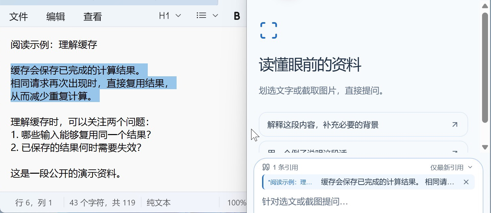
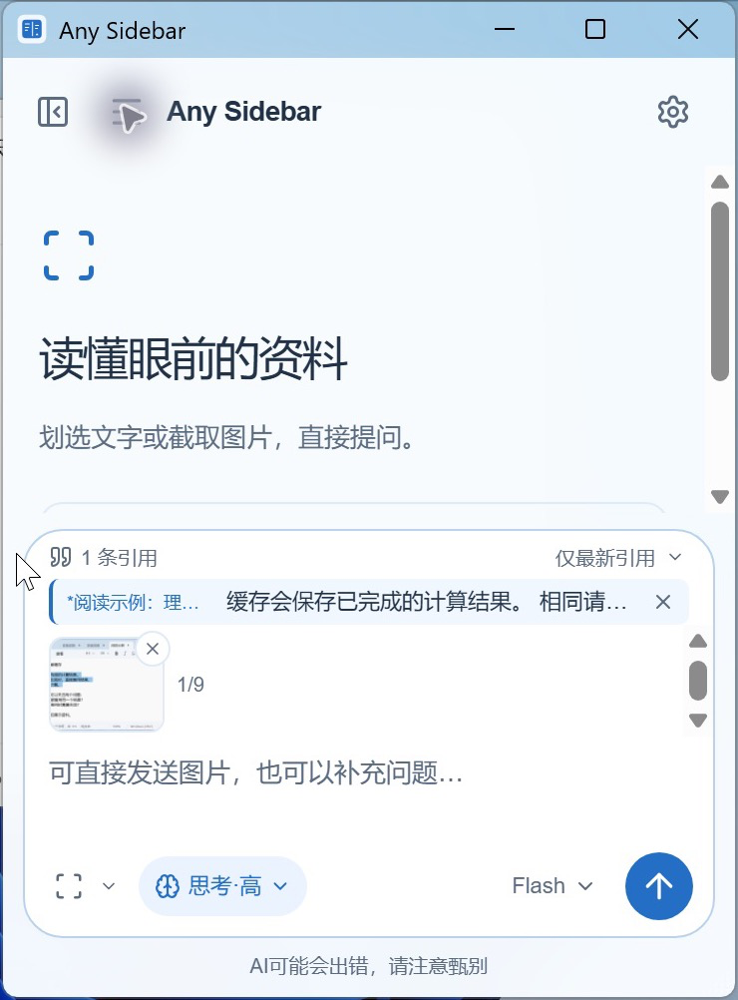
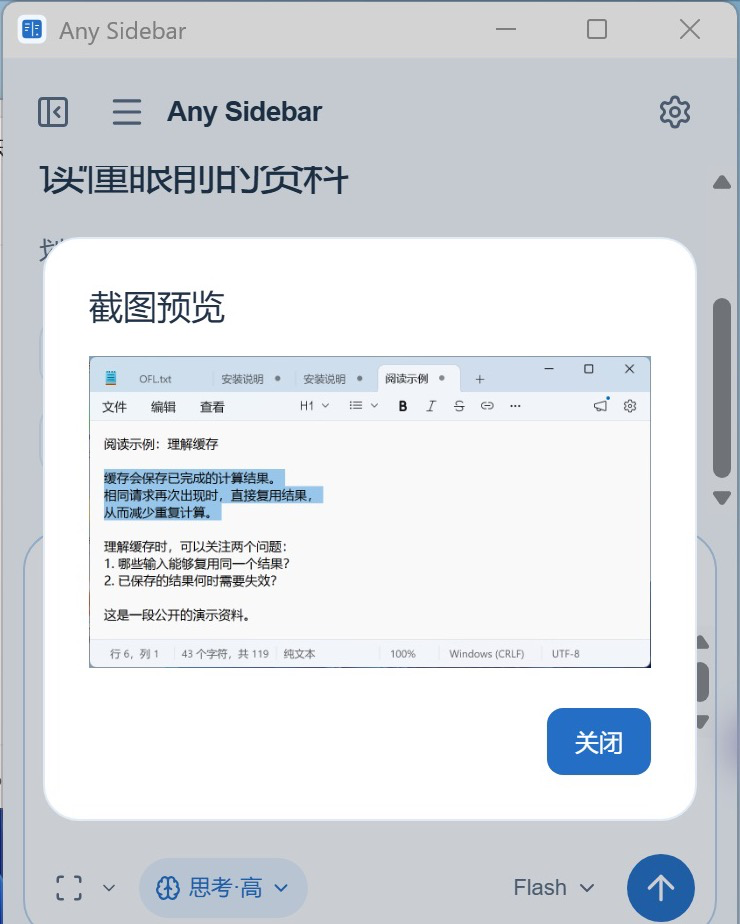

# Windows 界面截图

以下图片于 2026-11-10 在 VMware Fusion 的 Windows 11 ARM 虚拟机中截取。使用自编的公开缓存阅读示例，只裁剪了显示范围，没有改写界面或添加生成的回答；本轮没有调用模型。

## 选文进入引用区

在系统记事本中选中一段中文，侧栏自动接收，默认保留最新引用。

## 文字和截图一起准备

通过“读屏方式 → 选择窗口”截取记事本。文字引用与图片可以并存，截图先进入草稿，等待用户发送。

## 查看原图

打开缩略图后，可以核对截取内容，再决定是否发送。

本次确认了侧栏展开/收起、中文选文、窗口截图、缩略图和原图预览。[验证范围](validation-0.1.1.md#2026-11-10-windows-11-arm-补充实测)仍与完整兼容性测试分开记录。
